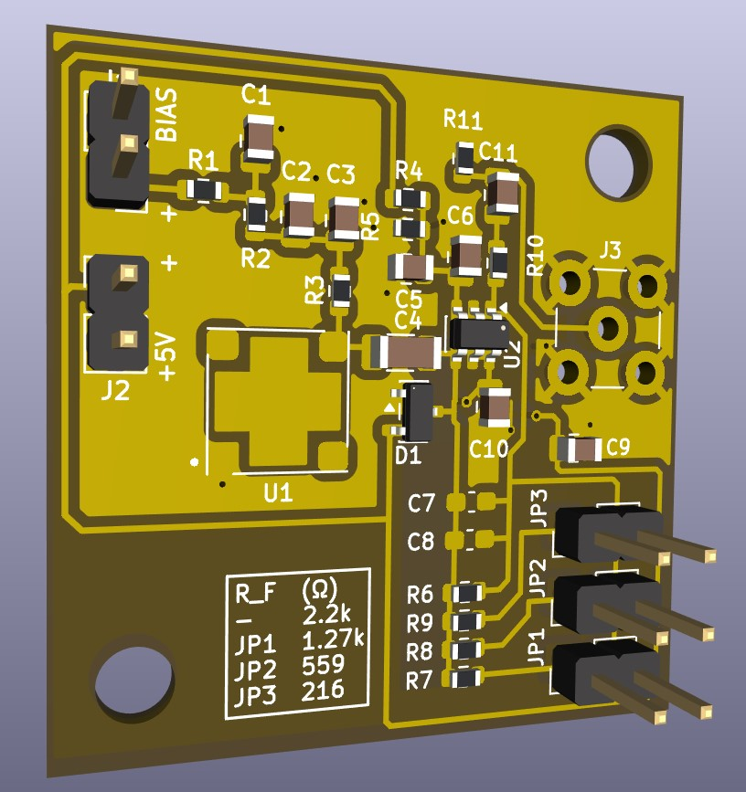
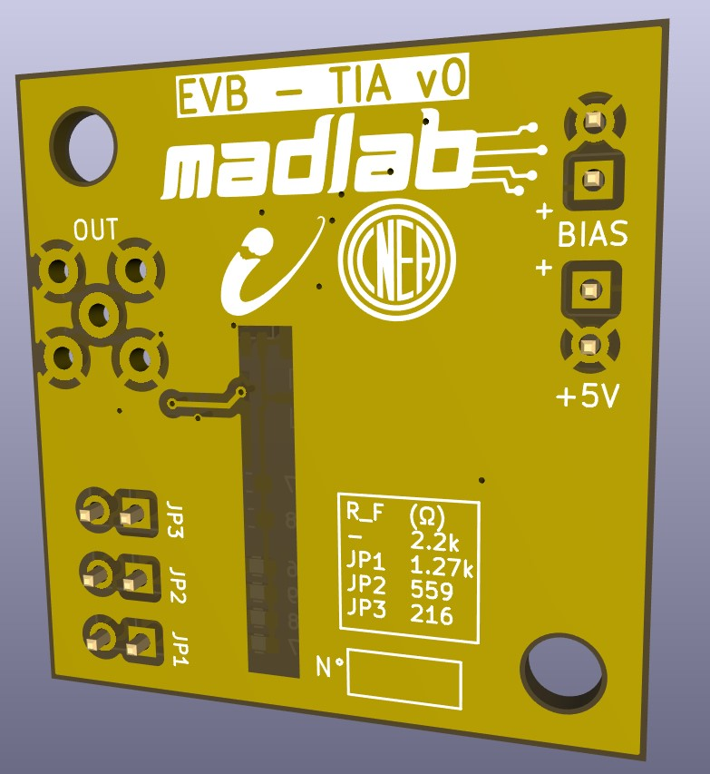
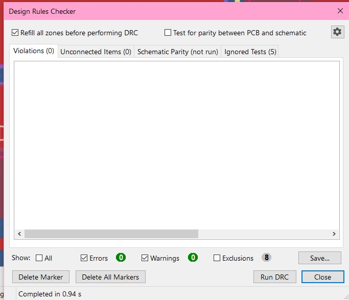

## Sesión de diseño de PCB: retoques finales de la EVB-TIA v0 con el director (mecánica, montaje, serigrafía)

**Tipo:** diseño de PCB (KiCad 10.0.5) y revisión con el director (José Lipovetzky). Sin trabajo experimental.
**Fechas:**
- 11/10: exportación de imágenes;
- 13/10: disponibilidad del SiPM, reunión con José y serigrafía;
- 14/10: este registro.

**Continúa:** LOG 10 (10–11/10), que cubre esquemático, floorplan compacto, ruteo, plano de masa y DRC con 0 errores. Acá se registra solo lo nuevo.

**Estado al cierre (actualizado 14/10):**
- Layout con los retoques de José y serigrafía terminada en las dos caras.
- **DRC: 0 errores, 0 advertencias, 0 ítems sin conectar (8 exclusiones).**
- Pendiente: chequeo final con José (Lipo) y Lara **antes** de generar los archivos de fabricación. Todavía no se generaron.

---

## Resumen

- **SiPM:** mismo modelo (MICROFC-60035-SMT), comprado y soldado por JLCPCB. Partes en su catálogo: C905854 (preferida), C22447851 y C603293. Falta confirmar stock en vivo.
- **Pad 5 del SiPM sin pasta:** **confirmado por el datasheet** (onsemi recomienda no soldarlo).
- **Retoques de José:**
  - conectores soldables en cualquier cara;
  - 2 agujeros de tornillo en esquinas opuestas;
  - J1 y J2 juntos y lejos de los tornillos;
  - C7/C8 separados para retrabajo;
  - headers y SMA soldados en el laboratorio.
- **Agujeros:** M3,5 (agujero NPTH de 3,7 mm) en esquinas diagonales, a 4 mm de cada borde, simétricos respecto del centro.
- **Serigrafía:**
  - textos a 0,8 mm y tabla de R_F en un recuadro;
  - logos de MADLAB, IB y CNEA convertidos para la cara de abajo;


---

## 1. Disponibilidad del SiPM en JLCPCB (13/10)

Faltaba verificar si el fabricante tenía el sensor (consulta 5).

**Hecho:** el catálogo de ensamblado de JLCPCB lista el sensor como parte *Extended*:

| Parte JLCPCB | Número de parte | Notas |
|---|---|---|
| C905854 | MICROFC-60035-SMT-TR1 (el del esquemático) | PCBA Economic y Standard, MSL 4 |
| C603293 | MICROFC-60035-SMT-TR | Solo PCBA Standard, pide inspección por rayos X, MSL 3 |
| C22447851 | MicroFC-60035-SMT | Economic y Standard |

- **Inferencia:** son el mismo sensor y el mismo encapsulado; cambia el sufijo de embalaje. El footprint sirve para cualquiera.
- **No verificado:** stock y precio. Las páginas los cargan dinámicamente y no se pudieron leer; hay que revisarlos en jlcpcb.com/parts.
- En LCSC solo figuran las placas de evaluación de onsemi (por ejemplo, MICROFC-SMA-60035-GEVB, sin stock, ~USD 415).

**Decisión (José, 13/10):** mismo modelo, comprado y soldado por JLCPCB. Se descartó enviar SiPM propios ya caracterizados (*consigned*).

---

## 2. Pad 5 del SiPM: confirmación con el datasheet

En el LOG 10 quedó registrado que se borró la pasta del pad 5 del footprint, pero sin el motivo. Ahora que el SiPM lo suelda JLCPCB, había que confirmarlo.

**Hecho** (onsemi, MICROC-SERIES/D, p. 10, nota de pines del MicroFC-60035-SMT):
- onsemi recomienda **no soldar** el paddle del pin 5 y dejarlo flotante, para optimizar la soldadura de los pines 1 a 4;
- el pin 4 ("No Connect") **sí** debe soldarse al PCB.

**Conclusión:** el footprint es correcto (pad 5 sin pasta, pad 4 con pasta). No hay cambios.

---

## 3. Retoques acordados con José (13/10)

| # | Pedido | Interpretación / decisión | Cómo quedó |
|---|---|---|---|
| 1 | "SMA y jumpers con salida de ambos lados" | Poder soldar el SMA y los headers en cualquiera de las dos caras (así lo interpreté y lo confirmé) | Ya se cumplía: son pasantes, con pads en `*.Cu` y máscara en `*.Mask` (verificado en el `.kicad_pcb`). No hubo cambios |
| 2 | 2 agujeros para tornillos, simétricos | Tornillos M3,5 (más fáciles de conseguir que M2,5). Primero se propusieron del mismo lado; José pidió **esquinas opuestas o lados opuestos** para repartir el esfuerzo | Esquinas diagonales (§4) |
| 3 | J1 y J2 más cerca entre sí y lejos de los tornillos | — | J1 y J2 apilados en el borde izquierdo, arriba |
| 4 | Mismo SiPM, soldado por JLCPCB | — | §1 |
| 5 | Separar C7 y C8 del resto para soldar y desoldar | — | Más espacio alrededor de C7/C8; siguen siendo las filas más cercanas a U2 |
| 6 | Pines (J1, J2, JP1–JP3) soldados en el laboratorio | Coherente con el punto 1: si los suelda JLCPCB, quedan fijos en la cara de arriba | Excluidos de BOM y posiciones (§6) |

### 3.1 Iteraciones del floorplan (artifact "Floorplan EVB-TIA v0")

| Versión | Placa | Agujeros | Comentario |
|---|---|---|---|
| v2 (LOG 10) | 33,5 × 34,5 mm | Ninguno | Compacta |
| v3 | 38,5 × 42,5 mm | 2 × M3 en las esquinas inferiores | Descartada: los dos tornillos del mismo lado concentran el esfuerzo |
| v4 | 38,5 × 36 mm | 2 × M3,5 en los lados izquierdo y derecho, a la misma altura | Propuesta intermedia |
| **Final** | **33,5 × 34,5 mm** | **2 × M3,5 en esquinas diagonales** | Reordené la placa sobre la v2: J1/J2 apilados arriba a la izquierda, SMA bajado, agujeros en las esquinas libres |

La versión final logra los requisitos **sin agrandar la placa**, a diferencia de la v3 y la v4. La referencia definitiva es el archivo de KiCad, no el artifact.

### 3.2 C7/C8: ¿al final del banco o primeros?

Se propuso mover C7/C8 al extremo exterior del banco (primero las resistencias, después los capacitores, mirando desde U2) para que sea más fácil soldarlos.

**Análisis (estimación, no medido):**

| Posición de C_F | Lazo de C_F | L parásita | Resonancia con C_F = 350 pF |
|---|---|---|---|
| Primeros (actual) | ~20 mm | ~15 nH | ~70 MHz |
| Al final del banco | ~45 mm | ~30–40 nH | ~45 MHz |

- El cruce del lazo está en el orden de 140 MHz (GBW 1,5 GHz / ganancia de ruido ~10,7). Bajar la resonancia de la rama de C_F hacia esa zona *podría* reducir el margen de fase con R_F = 159 Ω y C_F grande.
- **Decisión:** C7/C8 siguen siendo las filas más cercanas a U2, con más espacio alrededor para retrabajo.
- **Pendiente:** si se quiere moverlos al final, simular antes en LTspice con 15 y 40 nH en serie con C_F (159 Ω / 350 pF).

**Comentario sobre la revisión:** en una captura se estimó que el área sin cobre de TIA_IN estaba corrida y que las resistencias estaban demasiado juntas. Era un error de lectura a baja resolución; con zoom ambas cosas estaban bien. Yo solo había desplazado el bloque, sin cambiar el paso.

---

## 4. Agujeros de montaje

### 4.1 Diámetro

- Tornillo **M3,5** → agujero de paso de **3,7 mm** (ISO 273, ajuste fino; medio 3,9, holgado 4,2). Un agujero de 3,5 mm no deja margen para la tolerancia de perforación.
- **Pendiente:** medir con calibre la rosca de los tornillos del laboratorio.
  - ≈ 3,5 mm → M3,5 → `MountingHole_3.7mm`.
  - ≈ 3,0 mm → M3 → `MountingHole_3.2mm_M3`, o 3,5 mm si se quiere más juego.

### 4.2 Footprint y atributos

- Footprint `MountingHole:MountingHole_3.7mm`: NPTH, sin anillo de cobre, el tornillo no queda conectado eléctricamente.
- **Alternativa:** `MountingHole_3.7mm_Pad`, con anillo a GND, si en el futuro se quiere poner a masa una caja metálica.
- Referencias **H1/H2** (antes mostraban `REF**`), con la referencia y el valor ocultos.
- Atributos: **Not in schematic**, **Exclude from BOM**, **Exclude from position files**. Sin *Not in schematic*, F8 puede marcarlos como sobrantes.

### 4.3 Posición

Contorno real (Edge.Cuts): **(113,2; 53,75) → (146,7; 88,25)**, 33,5 × 34,5 mm, centro (129,95; 71,0). La placa ya no arranca en (100, 50).

| Agujero | X | Y |
|---|---|---|
| H1 (abajo a la izquierda) | 117,2 | 84,25 |
| H2 (arriba a la derecha) | 142,7 | 57,75 |

- Distancia de 4 mm desde cada borde: la cabeza de un M3,5 (radio ~3,25 mm) queda a ~0,75 mm del borde.
- Simetría respecto del centro: X₁ + X₂ = 259,9 = 2 × 129,95; Y₁ + Y₂ = 142,0 = 2 × 71,0.
- Alternativa con más margen: d = 4,5 mm → (117,7; 83,75) y (142,2; 58,25).
- **Verificar:** que la cabeza del tornillo de H2 no apoye sobre la brida del SMA y que el cable SMA se pueda enroscar con el tornillo puesto (estimado ~1,3 mm entre la cabeza y la pata más cercana del SMA).

**Problema de KiCad registrado:** al hacer doble clic sobre el agujero se edita el **pad**, no el footprint. Si se mueve, el agujero se separa de sus círculos. Para mover el footprint completo:
- destildar *Pads* en *Selection Filter*; o
- clic derecho → *Footprint H1* → **E**; o
- **Ctrl+F** y buscar "H1".

---

## 5. DRC: isla en la pata G2 del SMA

**Error:** *"Thermal relief connection to zone incomplete (2 spokes connected to isolated island)"* en el pad G2 de J3.

- **Causa:** en F.Cu, las pistas VOUT y TIA_OUT encerraban el relleno alrededor de G2. Los rayos de alivio llegaban a una isla y no al plano principal.
- **Impacto eléctrico:** despreciable. G2 es pasante y está conectado al plano de B.Cu, y G1, G3 y G4 están bien.
- **Soluciones:**
  1. una vía de GND dentro de la isla (recomendada);
  2. excluir el error, documentándolo.
- Al mover el SMA en la versión final, la geometría cambió: verificar en el próximo DRC si el error persiste.

---

## 6. Montaje: qué suelda JLCPCB y qué el laboratorio

| JLCPCB (SMT) | Laboratorio |
|---|---|
| SiPM (U1), U2, D1, R1–R11, C1–C6, C9–C11 | J1, J2, JP1–JP3, J3 (SMA) |
| | C7, C8 (C_F), según el centellador |

**Cómo marcarlo:**
- En el esquemático (la fuente de verdad), en J1, J2 y JP1–JP3: **Exclude from bill of materials**.
- En el PCB, después de F8: verificar **Exclude from position files**.
- No usar DNP: estos componentes sí se montan, solo que no los monta JLCPCB.

**Nota:** el visor 3D sigue mostrando los headers porque las exclusiones solo afectan el BOM y el CPL. El SMA no se ve porque el footprint propio de Lara no tiene modelo 3D, no por las exclusiones. La verificación real se hace en el archivo CPL.

---

## 7. Serigrafía

### 7.1 Criterios

- **Referencias** a 0,8 mm de alto y 0,15 mm de grosor (*Edit → Edit Text & Graphics Properties*). *Constraints → Silk → Minimum text height* bajado a 0,8 mm.
- Nada sobre pads, vías sin tapar, agujeros, la zona de la cabeza de los tornillos, ni el SiPM o el área del cristal.
- **Costo:** la serigrafía estándar en las dos caras no tiene costo extra en JLCPCB.

### 7.2 Contenido

**Cara de arriba (F.Silkscreen):**
- `BIAS ~30V` junto a J1, `+5V` junto a J2, `OUT` junto a J3;
- tabla de R_F en un recuadro (*Add Text Box* con borde), junto a los jumpers:

  ```
  R_F (Ω)
  —    2.2k
  JP1  1.27k
  JP2  559
  JP3  216
  ```

  Combinaciones en paralelo: JP1+JP2 = 471 Ω; todos = 159 Ω (tabla completa en el LOG 9).

**Cara de abajo (B.Silkscreen):**
- título `EVB-TIA v0` (1,5 mm, *knockout*) y subtítulo `Amplificador TIA para SiPM` (0,8 mm);
- logos de **MADLAB, IB y CNEA** (§7.3);
- `N°` con recuadro de ~6 × 2,5 mm para numerar cada placa con marcador. Se descartaron los campos SiPM y cristal, porque el SiPM va soldado;
- `JLCJLCJLCJLC` (0,8 mm): JLCPCB reemplaza ese texto por el número de pedido. Así no lo imprime en un lugar arbitrario y es gratis; quitarlo tiene un pequeño recargo;
- etiquetas de los conectores repetidas (BIAS/GND, +5V/GND, OUT, JP1–JP3), porque se pueden soldar de cualquier lado.

**Decisión:** no pongo mi nombre, sino el nombre de la placa y las instituciones.

### 7.3 Logos

- **Procesamiento** (Python): los originales en color se compusieron sobre blanco, se pasaron a tinta negra (CNEA: anillos celestes a negro), se reescalaron ×6 con suavizado, se binarizaron y se recortaron. Del logo combinado se separó MADLAB del de IB.
- **Archivos:** `logo_IB_bn.png`, `logo_CNEA_bn.png`, `logo_MADLAB_bn.png`.
- **Trazo mínimo medido a escala** (JLCPCB recomienda ≥ ~0,15 mm):

| Logo | Ancho recomendado | Trazo mínimo |
|---|---|---|
| IB | 8 mm | ~0,10 mm a 7 mm; el detalle del perfil dentro de la "i" probablemente se empaste |
| CNEA | 7 mm | ~0,27 mm |
| MADLAB | 16–18 mm | ~0,14 mm a 16 mm (las líneas de circuito); 18 mm es más seguro |

- **En KiCad:**
  1. *Image Converter* → *Footprint (.kicad_mod)*, capa **F.Silkscreen** (el conversor no ofrece B.Silkscreen);
  2. se guarda en `EVB-TIA.pretty`;
  3. se coloca con **A** y se pasa a la cara de abajo con **F** (*Flip*); en pantalla se ve espejado, y es lo correcto;
  4. atributos: *Not in schematic* y las dos exclusiones.

---

## 8. Alimentación de J1 (bias), para el uso de la placa

| J1 | Conexión |
|---|---|
| Pin 1 (pad cuadrado) | +V_bias (positivo) |
| Pin 2 | GND |

- **Tensión:**
  - V_bias = V_br + V_ov;
  - V_br ≈ 24,2–24,7 V a 21 °C (datasheet), sube ~21,5 mV/°C;
  - rango de trabajo 27 V (V_ov ≈ 2,5 V) a 29,5 V (V_ov ≈ 5 V), como en el LOG 9.
- **Fuente:** con límite de corriente bajo (~1 mA). En oscuridad el SiPM consume µA; con la polaridad invertida queda en directa y conduce mucho.
- **Orden de encendido:** primero +5 V, después el bias subiéndolo de a poco. Al apagar, al revés.
  - **Motivo:** el escalón de ~30 V en el cátodo pasa por C4 hacia −IN. D1 lo recorta, pero conviene que el amplificador ya esté alimentado.
- **Masas:** J1 y J2 comparten GND en la placa. Usar fuentes flotantes, o unir las masas en un solo punto, para evitar lazos de masa.
- **Pendiente:** registrar con qué fuente o SMU se hicieron las curvas IV de agosto y usar la misma, para que V_bias sea comparable.

---

## 9. Exportar imágenes del PCB (11/10)

KiCad no exporta la vista del editor tal como se ve (con transparencias y la capa inactiva atenuada).

| Método | Resultado | Uso |
|---|---|---|
| Captura de pantalla (grilla y panel apagados, *Zoom to fit*, Win+Shift+S) | Idéntico al editor, ~30 px/mm | LOG, diapositivas |
| Varias capturas con más zoom, unidas después | Idéntico al editor, ~2× resolución | Tesis |
| *File → Plot* → SVG o PDF, en color | Vectorial, capas opacas | Figuras por capa (por ejemplo, solo B.Cu) |
| Visor 3D → *Export Current View as PNG* (con *Raytracing*) | Render fotorrealista | Póster EAMTA, presentaciones |

**Detalles de *Plot* en KiCad 10:**
- *Export → SVG* ya no existe: se hace desde *Plot*.
- Cada capa tildada en *Include Layers* genera **un archivo**. Las capas de *Plot on All Layers* se superponen en cada uno.
- Para un solo archivo combinado: una sola capa en *Include Layers* y el resto en *Plot on All Layers*.
- El orden de la lista define qué queda encima. En la primera prueba B.Cu tapó todo; hay que dejarla al fondo.

---

## 10. Recomendaciones pendientes para el pedido

- **Vías tapadas (*tented*):** en *Board Setup → Solder Mask/Paste*, verificar que las vías estén cubiertas en ambas caras. Así la serigrafía no se recorta y no hay cobre expuesto bajo las cabezas de los tornillos.
- **Acabado superficial: ENIG** en lugar de HASL. Deja pads planos, que es mejor para el SiPM y el SOT-23-6, a cambio de un recargo menor. A decidir con José.
- Revisión final en 3D de las dos caras.

---

## 11. Refinamiento final y DRC limpio (13/10 a la noche – 14/10)

### 11.1 Serigrafía final

**Cara de arriba (F.Silkscreen):**
- `BIAS` junto a J1 y `+5V` junto a J2. Un `+` en el pin 1 (pad cuadrado) de cada uno marca la polaridad.
- Tabla de R_F en un recuadro, a la izquierda del banco.
- Referencias acomodadas y legibles.

**Cara de abajo (B.Silkscreen):**
- título `EVB – TIA v0` en *knockout*;
- logos de madlab, IB y CNEA;
- etiquetas `OUT`, `BIAS` y `+5V` con sus `+`, y `JP1`–`JP3` junto a sus pads (los conectores se pueden soldar de cualquier lado);
- tabla de R_F repetida;
- recuadro `N°`.

**Decisiones:**
- No se agrega `BIAS ~30V`: lo considero innecesario, alcanza con `BIAS` y la marca `+`.
- No se agrega `JLCJLCJLCJLC`: JLCPCB imprimirá el número de pedido donde decida. Al hacer el pedido se puede elegir quitarlo (con un recargo chico) o aceptarlo así; es solo estético.

### 11.2 Correcciones de serigrafía por el DRC

| Advertencia | Causa | Acción |
|---|---|---|
| *Text thickness out of range* (0,10 < 0,15 mm) en `OUT`, `BIAS`, `+5V` y la tabla de R_F, en las dos caras | Textos nuevos creados con el grosor por defecto | Grosor llevado a 0,15 mm |
| *Text height out of range* (0,6 < 0,8 mm) en los cuatro `+` | Tamaño elegido a mano | Llevado a 0,8 mm |
| *Silkscreen clipped by solder mask* en U1 (pads 3, 4…) | El contorno de serigrafía del footprint del SiPM, heredado de Lara, pasa por encima de los pads; JLCPCB recorta la tinta ahí | **Excluido.** Es estético: el contorno sale con cortes |

**Resultado:** 0 errores, 0 advertencias, 0 sin conectar, **8 exclusiones**. El error de la isla en G2 del SMA (§5) ya no aparece después del reordenamiento.

**Las 8 exclusiones** (las verifiqué el 14/10) son todas *Silkscreen clipped by solder mask* del contorno de serigrafía de U1 (SiPM) sobre sus pads. No hay exclusiones de otro tipo.

### 11.3 Otras verificaciones

- **Vías tapadas:** *Board Setup → Solder Mask/Paste → Tent vias: Front ✓ Back ✓*. Confirmado.
- **Headers verticales:** en una revisión del render 3D se interpretó que los pines eran en ángulo recto. Era un efecto de la perspectiva: los pines son verticales. No hubo cambios.






---

## Pendientes

- [ ] **Chequeo final con José (Lipo) y Lara** antes de generar archivos. Puntos a mostrar:
  - J2 a ~2,5 mm del courtyard del SiPM;
  - tornillo H2 cerca del SMA;
  - C7/C8 como primeras filas del banco.
- [x] Documentar las 8 exclusiones del DRC (§11.2): todas del contorno de U1.
- [x] Confirmar el stock de C905854 (SiPM) y C654293 (ADA4895) en JLCPCB. → Incluidos en el pedido (LOG 12).
- [ ] Medir los tornillos (M3 o M3,5) y confirmar el diámetro del agujero.
- [ ] Verificar el espacio entre la cabeza del tornillo H2 y el SMA con las piezas reales.
- [x] DRC final: 0 errores, 0 advertencias, 0 sin conectar.
- [x] Serigrafía de las dos caras: logos, etiquetas, polaridad, tabla de R_F, `N°`.
- [x] Vías tapadas en las dos caras.
- [x] Decidir ENIG o HASL, y si se quita el número de pedido de JLCPCB. → LeadFree HASL y *Remove Mark* (LOG 12).
- [x] Generar Gerbers, taladros, BOM y CPL. → LOG 12.
- [ ] (Opcional) Simular C_F con 15 y 40 nH en serie si se quiere mover C7/C8 al final del banco.
- [ ] (Opcional) Asignar un modelo 3D al SMA para los renders.

## Archivos

> [!IMPORTANT]
> El proyecto KiCad se encuentra en: `hardware/EVB-TIA-v0/`. Los logos en blanco y negro, en `hardware/EVB-TIA-v0/logos/`.

- Proyecto KiCad: `EVB-TIA-v0.kicad_pcb` modificado con los retoques. Logos en `EVB-TIA.pretty`.
- Logos en blanco y negro: `logo_IB_bn.png`, `logo_CNEA_bn.png`, `logo_MADLAB_bn.png`.
- Artifact "Floorplan EVB-TIA v0", versiones 3 y 4 (propuestas intermedias).
- `Consultas_pendientes_EVB-TIA.md`: consultas 2, 5 y 8 marcadas como decididas.

## Referencias

- onsemi, MICROC-SERIES/D (p. 10: pines 4 y 5 del MicroFC-60035-SMT).
- JLCPCB, fichas de las partes C905854, C603293 y C22447851; *PCB Manufacturing Capabilities*.
- ISO 273, agujeros de paso para tornillos.
- LOG 9 (banco de R_F, tensiones de bias simuladas) y LOG 10 (diseño de la placa).
