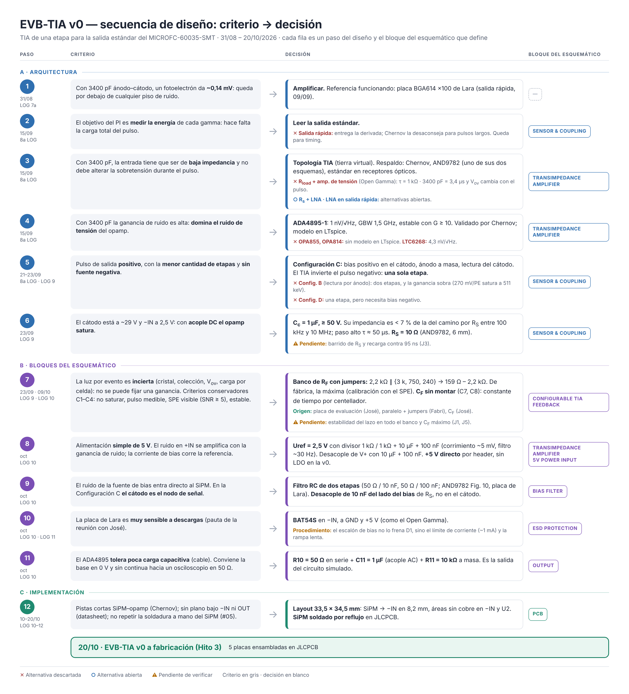

# Trazabilidad del diseño de la electrónica de amplificación — de la placa de Lara a la EVB-TIA v0

**Período:** 31/08/2026 – 20/10/2026.
**Fuentes:** LOG 7a, 7, 8a, 9, 10, 11 y 12; documentos de soporte del 8a; chat de diseño en KiCad.
**Objetivo de este documento:** que cada parte del circuito fabricado se pueda rastrear hasta el criterio de ingeniería que la origina.

> [!NOTE]
> Los puntos que no tenían un criterio registrado se revisaron el 21/10 (ver §5 y §6).

---

## 1. Requisitos de partida

| # | Requisito | Origen |
|---|---|---|
| RQ1 | Medir la **energía** de cada gamma (espectros de altura de pulso, 511 keV vs dispersados) | Propuesta del PI, objetivo 1 |
| RQ2 | Ver el **fotoelectrón individual** (calibración con cuentas oscuras) | LOG 9, criterio C3 |
| RQ3 | Cubrir **LYSO y GSO** sin rediseñar, con una colección de luz desconocida | LOG 9 §4 |
| RQ4 | El fotopico **no satura** y es **medible** (0,5–2,2 V sobre la base) | LOG 9, criterios C1 y C2 |
| RQ5 | **Estable**: sin ringing, undershoot < 5 % | LOG 9, criterio C4 |
| RQ6 | Proteger los amplificadores (la placa de Lara es muy sensible a descargas) | Reunión con José, 8a LOG §1 |
| RQ7 | Costo y simplicidad: SMA soldados en el laboratorio, placa limpia, sin componentes opcionales sin uso | Reunión con José; criterio propio (LOG 10) |
| RQ8 | Corrección térmica separada, con jumper | Reunión con José, 8a LOG §1 |

**Restricciones fijas:** SiPM MICROFC-60035-SMT, con 3400 pF ánodo–cátodo y 48 pF en la salida rápida (datasheet, Tabla 1); ganancia de 3×10⁶ a V_ov = 2,5 V; ~2500 PE por gamma de 511 keV (estimación); LYSO con τ = 40 ns y GSO con 56 ns + 400 ns.

---

## 2. Línea de tiempo

| Fecha | Etapa | Qué se decidió o cambió | Por qué | Fuente |
|---|---|---|---|---|
| 31/08 | Diagnóstico | Hace falta amplificar | Con 3400 pF la salida estándar da ~0,14 mV/PE: invisible | LOG 7a |
| 09/09 | Referencia | La placa BGA614 ×100 de Lara (salida rápida) muestra fotones individuales | Valida la cadena SiPM → amplificador → osciloscopio | LOG 7 |
| 15/09 | Reunión | 2–3 circuitos para probar; el de Chernov obligatorio; protecciones; SMA soldados a mano; corrección térmica aparte | Pautas de José y comunicaciones ópticas | 8a LOG §1 |
| 15/09 | Salida del SiPM | **Salida estándar** | Tiene la carga total → energía (RQ1). Chernov desaconseja la salida rápida para pulsos largos | 8a LOG §3 |
| 15/09 | Topología | **TIA** | Validación de Chernov; es uno de los dos esquemas de lectura de la salida estándar de la AND9782/D (TIA o resistencia de sensado, sin preferencia); estándar en receptores ópticos. Tierra virtual: la sobretensión no cambia durante el pulso, a diferencia de una R_load | 8a LOG §4–5 |
| 15/09 | Opamp | **ADA4895-1** (GBW 1,5 GHz, estable con G ≥ 10) | Validado por Chernov (valida el opamp, no nuestro circuito); el e_n más bajo (1 nV/√Hz), que es crítico con 3400 pF en la entrada. Los opamps de TI no tienen modelo en LTspice | 8a LOG §5.2 |
| 15/09 | Alternativas | Circuitos 2 (R_s + LNA) y 3 (LNA en la salida rápida) **no descartados** | Quedan para comparar; la placa de Lara es la referencia | 8a LOG §5.3 |
| 21/09 | Iteración 1 | TIA + inversor en **Configuración B** (lectura por ánodo), 2 × ADA4895, 5 V simple, Uref = 2,5 V | Leyendo por ánodo, el TIA invierte el pulso y hace falta otra etapa para que salga positivo | 8a LOG §6.2 |
| 21/09 | Iteración 1 | Inversor con ganancia −3,2 | Valores mayores oscilaban | 8a LOG §6.2 |
| ~22/09 | Bias | Lectura por **cátodo** | Pulso negativo → el TIA lo deja positivo con **una sola etapa** | 8a LOG §6.4, AND9782/D |
| ~22/09 | Ganancia | Dejar de iterar a ciegas y fijar criterios | 270 mV/PE satura a 511 keV: sirve para calibrar, no para espectroscopía | 8a LOG §6.5 |
| 23/09 | Iteración 2 | **Configuración C de una etapa**: +V_bias → R_S → cátodo, ánodo a GND | Una etapa alcanza (simulación) y no hace falta fuente negativa (la D sí la necesita). Según la AND9782/D, C y D solo empeoran el timing de la salida rápida, que no se usa: "still provide good performance otherwise" | LOG 9 §1, 8a LOG §6.6, AND9782/D p. 2 |
| 23/09 | Iteración 2 | Acople del cátodo con **C_c = 1 µF** | Con acople DC, −IN quedaba a ~29 V y la salida saturaba | LOG 9 §3 |
| 23/09 | Iteración 2 | **R_S = 10 Ω** | Valor de la AND9782/D para el sensor de 6 mm (como resistencia de sensado, Fig. 14). En simulación probé a mano valores entre 10 y 50 Ω mirando la forma del pulso, sin ver diferencias importantes; esas pruebas no quedaron registradas (J3) | LOG 9 §3; §6.2 (J3) |
| 23/09 | Iteración 2 | **Sin C_F** | Estable en simulación sin capacitor de realimentación | LOG 9 §3 |
| 23/09 | Ganancia | **Placa de evaluación con R_F variable** | Demasiadas incógnitas (cristal, colección de luz, V_ov, carga real por celda) para fijar una sola ganancia (RQ3) | LOG 9 §4 |
| 23/09 | Ganancia | R_F con resistencias **en paralelo y jumpers**; de fábrica, la más grande | Idea de José (placa de evaluación) y de Fabri (paralelo + jumpers) | LOG 9 §4 |
| 23/09 | Ganancia | Banco **2,2 kΩ ∥ {3 kΩ, 750 Ω, 240 Ω}** → 159 Ω – 2,2 kΩ | Estudio por escenarios con los criterios C1–C4. 2,2 kΩ: por encima casi no mejora la SNR del SPE (7,2 → 8,8 con 6,8 kΩ). 159 Ω: alcanza para las ventanas más bajas (S3–S5, 150–220 Ω); el caso que pedía ~65 Ω (LYSO, 50 % de colección, 5 V) se excluyó por estar cerca del límite de estabilidad: ahí se baja V_ov | LOG 9 §5–7 |
| 23/09 | Ganancia | Parásitos de los jumpers ≤ ~3 pF | Simulación estable hasta 5 pF; con R_F alta, el parásito recorta el pico del SPE | LOG 9 §6.6 |
| ~oct | Ganancia | **No volver a correr el escalado** con `q_scale` 1,2; el banco se mantiene | Decisión propia (falta anotarla en el LOG 9) | Chat de KiCad |
| ~oct | Alimentación | **+5 V directo** por header, sin LDO | Simplicidad para la v0; las baterías son tema de la sonda final | Chat de KiCad |
| ~oct | Uref | **Divisor 1 kΩ / 1 kΩ + 10 µF + 100 nF** | Con 1 kΩ, la corriente de bias (≤ 11 µA) corre Uref ~5 mV (con 10 kΩ, ~55 mV). El filtro de ~30 Hz evita que el ruido de 5 V entre a +IN en 1–20 MHz, donde la ganancia de ruido es enorme. Una referencia de precisión solo mejoraría la estabilidad DC de la base. Misma estructura que el divisor de la placa de Lara | Chat de KiCad |
| ~oct | Bias | **Filtro RC de dos etapas** (50 Ω/10 nF, 50 Ω/100 nF) | AND9782/D Fig. 10; es el filtro de Lara, ya probado | LOG 10, chat de KiCad |
| ~oct | Bias | **C3 = 10 nF del lado del bias de R_S**, no en el cátodo | En la Configuración C el cátodo es el nodo de señal: un capacitor ahí se llevaría el pulso a masa | Chat de KiCad |
| ~oct | Protección | **BAT54S** en −IN, a los rieles | Protección contra descargas (RQ6), como en el Open Gamma Detector | Discusión §7.1, LOG 10 |
| ~oct | Protección | Resistencias de protección de la reunión **no incluidas** | Se pasaron por alto en el diseño. La placa pasó la revisión de José sin ellas | — |
| ~oct | Salida | **R10 = 50 Ω** en serie | El ADA4895 tolera poca carga capacitiva: sin resistencia, el cable puede hacerlo oscilar. Además adapta a 50 Ω | Chat de KiCad, LOG 10 |
| ~oct | Salida | Se probó salida en DC (0 Ω) con filtro sin montar → se volvió a **C11 = 1 µF + R11 = 10 kΩ** | Es el circuito simulado: C11 lleva la base de 2,5 V a 0 V. El filtro sin montar se sacó (placa limpia, RQ7) | LOG 10 §3.2 |
| ~oct | SiPM | **Salida rápida (pin 2) sin conectar**; se quitó la toma de Lara (R22, J11) | No se usa en esta placa (AND9782/D p. 6); placa limpia | LOG 10 §3.2 |
| ~oct | SiPM | **Pad 5 sin pasta**, pad 4 soldado | Recomendación de onsemi (datasheet p. 10) | LOG 10–11 |
| 09/10 | C_F | **Dos footprints de C_F sin montar** (C7, C8) | José: ajustar la constante de tiempo a cada centellador soldando C_F en el laboratorio. El valor máximo admisible sale de J5 (§6.4). La cota C_F ≲ 380 pF (de 1 + 3400 pF / C_F ≥ 10) es preliminar y puede ser optimista | LOG 10 §3.2 |
| 10/10 | Layout | SiPM → −IN en **8,2 mm**; lazo de C_F de 19 mm; sin cobre bajo −IN y U2; jumpers del lado de la salida | Chernov: pistas cortas. Datasheet del ADA4895: sin plano bajo −IN ni OUT. Menor capacidad parásita en −IN (LOG 9 §6.6) | LOG 10 §6–8 |
| 10/10 | Footprints | C_c (C4) en 1206, ≥ 50 V | Está sobre el bias de ~30 V | LOG 10 §4 |
| 13/10 | Mecánica | Conectores soldables de ambos lados, 2 tornillos en esquinas opuestas, J1/J2 juntos | Pedido de José | LOG 11 §3 |
| 13/10 | Montaje | **SiPM soldado por JLCPCB** (mismo modelo) | Repetibilidad; evitar el daño por soldadura a mano del #05 (LOG 6) | LOG 11 §1 |
| 19–20/10 | Fabricación | Partes elegidas, márgenes de tensión ≥ ×1,6, pasta SAC305, sin limpieza ni coating | AND9788/D (reflujo ≤ 260 °C, IPA concentrado daña el encapsulado) | LOG 12 |

---

## 3. Del criterio al componente

Cada componente de la EVB-TIA v0 y el criterio que lo origina.

### 3.1 Bias del SiPM

| Ref. | Valor | Función | Criterio |
|---|---|---|---|
| J1 | Header 1×2 | Entrada de bias | Igual que la placa de Lara |
| R1, C1 | 50 Ω, 10 nF | 1.ª etapa del filtro (~320 kHz) | AND9782/D Fig. 10; probado en la placa de Lara |
| R2, C2 | 50 Ω, 100 nF | 2.ª etapa del filtro (~32 kHz) | Ídem |
| C3 | 10 nF, 50 V | Desacople local del bias | AND9782/D: desacople en el terminal de bias. Va antes de R3 porque el cátodo es el nodo de señal. La nota pide 100 V; se usó 50 V con margen ×1,6 sobre el bias máximo de ~31 V (LOG 12 §6.1) |
| R3 | 10 Ω | Resistencia serie del bias (R_S) | Valor de onsemi para 6 mm (AND9782/D, Fig. 14). Criterio físico: la resistencia serie alarga la recarga de las microceldas en R_S·C_SiPM (AND9782/D, ec. 1). Pendiente de verificar (J3) |

### 3.2 Sensor y acople

| Ref. | Valor | Función | Criterio |
|---|---|---|---|
| U1 | MICROFC-60035-SMT | SiPM, Configuración C | Una etapa sin fuente negativa (8a LOG §6.6) |
| C4 | 1 µF, 50 V, 1206 | Acople cátodo → −IN (C_c) | Bloquea los ~30 V de continua (LOG 9). En la banda de la señal su impedancia es ≪ R3, así que la corriente va al TIA y no a R3 (§6.3) |
| Pin 2 | Sin conectar | Salida rápida | AND9782/D: si no se usa, dejarla flotante, sin cables |
| Pad 5 | Sin pasta | Paddle | Datasheet p. 10 |
| Pad 4 | Soldado, sin conexión | NC | Quedó así porque el símbolo heredado no tiene el pin 4. Según la AND9782/D, los pines NC no están conectados eléctricamente, pero llevarlos a un plano mejora la disipación. Evaluar para la v1 |

### 3.3 Protección

| Ref. | Valor | Función | Criterio |
|---|---|---|---|
| D1 | BAT54S | Clamp de −IN a GND y +5 V | Protección contra descargas (RQ6); práctica del Open Gamma Detector |

### 3.4 Amplificador

| Ref. | Valor | Función | Criterio |
|---|---|---|---|
| U2 | ADA4895-1 | TIA | 8a LOG §5 |
| DIS | A +5 V | Siempre habilitado | Datasheet p. 16 |
| J2 | Header 1×2, +5 V | Alimentación | Simplicidad v0, sin LDO |
| C9, C10 | 10 µF, 100 nF | Desacople de V+ | Datasheet p. 22; C10 pegado al pin 6 |
| R4, R5 | 1 kΩ, 1 kΩ | Uref = 2,5 V | Alimentación simple; corrimiento por I_bias ~5 mV |
| C5, C6 | 10 µF, 100 nF | Filtro de Uref (~30 Hz) | Ruido en +IN se amplifica con la ganancia de ruido |

### 3.5 Realimentación

| Ref. | Valor | Función | Criterio |
|---|---|---|---|
| R6 | 2,2 kΩ | R_F base (fábrica) | Máxima ganancia útil: calibración con SPE, SNR ≈ 7 (LOG 9 §6.7) |
| R7 + JP1 | 3 kΩ | Rama → 1,27 kΩ | Banco del LOG 9 §7 (salto máximo 2,27×) |
| R8 + JP2 | 750 Ω | Rama → 559 Ω | Ídem |
| R9 + JP3 | 240 Ω | Rama → 216 Ω; todos → 159 Ω | Ídem; cubre LYSO |
| C7, C8 | Sin montar | C_F | Constante de tiempo por centellador (José, 09/10) |

### 3.6 Salida

| Ref. | Valor | Función | Criterio |
|---|---|---|---|
| R10 | 50 Ω | Resistencia serie | Aísla al opamp del cable; adapta a 50 Ω |
| C11 | 1 µF | Acople AC | Circuito simulado; base a 0 V |
| R11 | 10 kΩ | Referencia a masa | Ídem |
| J3 | SMA | Conector | Soldado en el laboratorio (RQ7) |

---

## 4. Las pautas de la reunión y cómo quedaron

| Pauta (15/09) | Estado en la EVB-TIA v0 |
|---|---|
| Circuito de Chernov (obligatorio) | ✅ TIA con ADA4895, adaptado a la salida estándar |
| 2–3 circuitos para probar | ⏳ Uno fabricado; circuitos 2 y 3 abiertos; la placa de Lara como referencia |
| SMA soldados en el laboratorio | ✅ Excluido del BOM |
| Resistencias de protección que se puentean después | ❌ Se pasaron por alto; la placa pasó la revisión de José sin ellas. Evaluar para la v1 |
| Diodos de protección | ✅ BAT54S |
| Amperímetro o voltímetro para cada salida | ✅ Salida estándar: amperímetro (TIA). Salida rápida: sin evaluar en esta placa |
| Corrección térmica en plaquita aparte | ⏳ Después de la Tarea 3 |
| Pulsos largos para espectroscopía | ✅ Salida estándar |

---

## 5. Puntos revisados el 21/10

1. **Resistencias de protección.** Se pasaron por alto en el diseño. La placa pasó la revisión de José sin ellas. Para la v1, evaluar si hacen falta según lo que pase en la puesta en marcha.
2. **Protección contra el escalón del bias.** D1 no protege contra el escalón: antes conducen los diodos internos del ADA4895 entre +IN y −IN, que toleran menos de 10 mA. La protección real es el **límite de corriente de la fuente de bias** (~1 mA) más la **rampa lenta**. LOG 11 §8 corregido.
3. **Pin 4 del SiPM.** Quedó sin conexión porque el símbolo heredado no tiene ese pin, no por una decisión de diseño. Para la v1, evaluar llevarlo a GND.

---

## 6. Justificaciones revisadas (21/10)

### 6.1 Cerradas

| # | Tema | Justificación |
|---|---|---|
| J2 | **Umbrales de los criterios C1–C4** (2,2 V; 0,5 V; SNR ≥ 5; undershoot < 5 %) | Criterios de diseño **conservadores**, adoptados para acotar un espacio de diseño con demasiadas variables libres. El objetivo era asegurar que el pulso se vea a la salida sin saturar. No son especificaciones del sistema final: esas dependen del ADC, que todavía no está definido |
| J4 | **C_c = 1 µF** | Cálculo de abajo (§6.3) |
| J6 | **Banco sin volver a simular con `q_scale` 1,2** | Prioridad de tiempo: había que mandar la placa a fabricar lo antes posible, y asumí que el banco seguía siendo adecuado. Argumento que lo respalda: los valores del banco caen dentro de las ventanas de los cinco escenarios con las dos hipótesis simuladas (1,0 y 1,53), y 1,2 queda entre ambas. Se puede verificar en simulación más adelante |
| J7 | **Supuestos** (colección de luz del 25–50 %, crosstalk del 20 % a 5 V, ~2500 PE) | Supuestos de diseño propios, deliberadamente amplios, para tener un criterio con el que dimensionar. Se validan con la placa: el cociente fotopico/SPE da la colección de luz real (LOG 9, pendientes) |

### 6.2 Abiertas

| # | Tema | Qué falta | Cuándo |
|---|---|---|---|
| J1 | **Estabilidad del TIA** | Simulación de la ganancia de lazo (tarea definida en §6.4) | Antes de medir con la EVB |
| J3 | **R3 = 10 Ω** | Las pruebas manuales entre 10 y 50 Ω (mirando la forma del pulso) no quedaron registradas, ni la R_F usada. Hacer un barrido sistemático dentro de la tarea de §6.4 y registrarlo. El valor de 10 Ω de onsemi es para una resistencia de **sensado** (Fig. 14); en nuestro circuito R3 no sensa, así que hace falta el criterio propio | Con J1 |
| J5 | **Regla para elegir C_F** | Sale de la misma simulación que J1: C_F máximo por R_F, más la relación R_F·C_F contra el centellador | Antes de soldar el primer C_F |
| J8 | **Archivos de simulación** | Subir al repo los `.asc`, los CSV y `escalado_spe_gamma.py` | Cuando se pueda |

### 6.3 Cálculo de C_c (J4)

**Modelo simplificado** (estimación, no medida): opamp de un polo con GBW = 1,5 GHz; fuente de bias como masa de alterna; filtro R1–C1–R2–C2 y C3 completos; C_c con 0,4 µF efectivos (pérdida por la tensión continua de ~28 V) y con 1 µF nominal.

La corriente del SiPM tiene dos caminos desde el cátodo: C_c hacia la entrada del TIA, o R3 hacia C3 y el filtro (Z_sh).

| f | \|Z_sh\| | \|Z_Cc\| con 0,4 µF | \|Z_Cc\| / \|Z_sh\| |
|---|---|---|---|
| 100 kHz | 58 Ω | 4,0 Ω | 6,8 % |
| 400 kHz | 37 Ω | 1,0 Ω | 2,7 % |
| 1 MHz | 20 Ω | 0,40 Ω | 2,0 % |
| 4 MHz | 11 Ω | 0,10 Ω | 0,9 % |
| 10 MHz | 10 Ω | 0,04 Ω | 0,4 % |

- **Criterio:** en toda la banda de la señal (desde ~100 kHz, por la componente lenta del GSO de 400 ns, hasta decenas de MHz), la impedancia de C_c es menos del 7 % de la del camino alternativo. C_c no limita la señal, ni siquiera con la capacidad reducida por la tensión continua.
- **Paso alto:** τ ≈ C_c · (R1 + R2 + R3) ≈ 44–66 µs. El undershoot que produce es del orden de τ_pulso / τ ≈ 1 % para el GSO (400 ns) y ≈ 0,1 % para el LYSO (40 ns). Cumple el criterio C4.
- **Lo que sí divide la corriente en alta frecuencia** es la impedancia de entrada del TIA (≈ R_F / A(f)): con R_F = 2,2 kΩ, a 10 MHz llega al TIA ~60 % de la corriente, y a 40 MHz ~20 %. Es el límite de ancho de banda del TIA, no de C_c; queda cubierto por la simulación del LOG 9 y por J1.

### 6.4 Tarea: simulación de la estabilidad del lazo (J1 y J5)

**Objetivo:** demostrar que el TIA es estable en todas las configuraciones del banco de R_F, y definir el C_F máximo admisible para cada una.

**Por qué hace falta:** el ADA4895 es estable con ganancia ≥ 10 (datasheet). Con 3400 pF en la entrada, la ganancia de ruido crece con la frecuencia, así que superar 10 no alcanza: lo que define la estabilidad es el margen de fase en el cruce de la ganancia de lazo. Hoy la estabilidad solo está verificada por la forma del pulso en el transitorio.

**Caso a mirar con más cuidado (hipótesis):** las R_F **bajas** (159–216 Ω), no las altas. Si algo en serie con la capacidad del SiPM (la resistencia interna del modelo, la ESR de los capacitores o R3) aplana la impedancia de entrada en alta frecuencia en unas decenas de ohms, la ganancia de ruido queda en ≈ 1 + R_F / R_serie. Con R_F = 159 Ω eso puede quedar cerca de 10, el mínimo del ADA4895. Por la misma razón, el C_F máximo puede ser bastante menor que la cota de 380 pF.

**Método:**
1. En LTspice, abrir el lazo en la salida del opamp, antes de la red de realimentación, con una sonda de ganancia de lazo (método de Tian o Middlebrook; LTspice trae un ejemplo).
2. Circuito completo: modelo de Chernov, R3, C3, filtro de bias, C_c (0,4 µF), capacidad de D1 (~10 pF), parásitos de los jumpers (≤ 3 pF), salida (R10, C11, R11 y la carga del osciloscopio en 50 Ω y en 1 MΩ ∥ ~15 pF).
3. Análisis AC de la ganancia de lazo: frecuencia de cruce, margen de fase, margen de ganancia.

**Casos:**
- R_F: las 8 configuraciones del banco (2,2 kΩ a 159 Ω);
- C_F: 0 y valores candidatos (por ejemplo 10, 47, 100, 220, 330 pF);
- inductancia de la rama de C_F: 0, 15 y 40 nH (LOG 11 §3.2).

**Criterio de aceptación:** margen de fase ≥ 65°. Justificación: en un sistema de segundo orden, 65° corresponde a un sobrepico de ~5 %, 60° a ~9 % y 45° a ~23 %. Con ≥ 65° el sobrepico queda dentro del criterio C4 (< 5 %), así que C4 queda vinculado a un criterio de estabilidad.

**Validación del método:** para algunos casos, comparar el margen de fase con el sobrepico y el ringing del transitorio.

**Barrido de R3 (J3), en la misma tarea:**
- R3 ∈ {10, 22, 50} Ω, con R_F = 2,2 kΩ y 159 Ω.
- Métricas: amplitud del SPE, constante de tiempo de la cola del SPE y margen de fase.
- **Criterio físico** (AND9782/D, ec. 1): la resistencia serie suma R_S·C_SiPM al tiempo de recarga de las microceldas: +34 ns con 10 Ω y +170 ns con 50 Ω, contra 95 ns nominales. En nuestra topología el SiPM ve R3 (más el filtro, parcialmente desacoplado por C3) en paralelo con la entrada del TIA, de baja impedancia. **Hipótesis:** por eso las pruebas manuales no mostraron diferencias. Hay que confirmarlo comparando la cola del SPE con los 95 ns del datasheet.
- La misma nota advierte que, en SiPM grandes, el filtro de bias puede alargar la recarga. Esta medición también lo verifica.

**Entregables:**
- tabla de margen de fase por R_F y C_F;
- C_F máximo admisible por R_F (regla para soldar C_F, J5);
- gráficos de Bode y archivos en `sim/`;
- registro en un LOG.

---

## 7. Secuencia de diseño: criterio → decisión

Vista general del proceso: cada fila es un paso, en el orden en que se dio, con el criterio de ingeniería que lo motivó, la decisión tomada (incluidas las alternativas descartadas o abiertas) y el bloque del esquemático que define. Cubre la topología y los siete bloques del esquemático. El detalle por componente está en las secciones 2 y 3.

